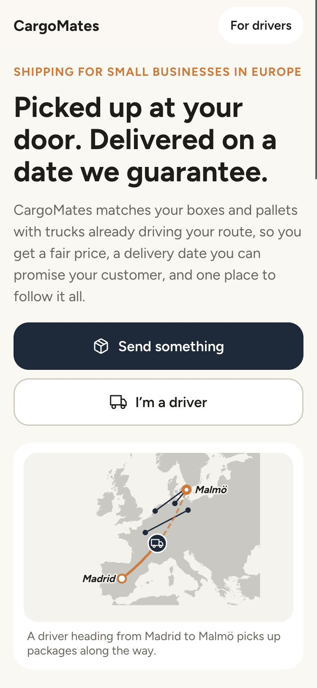
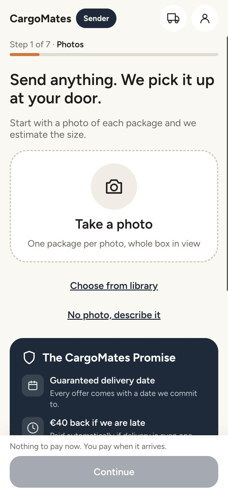
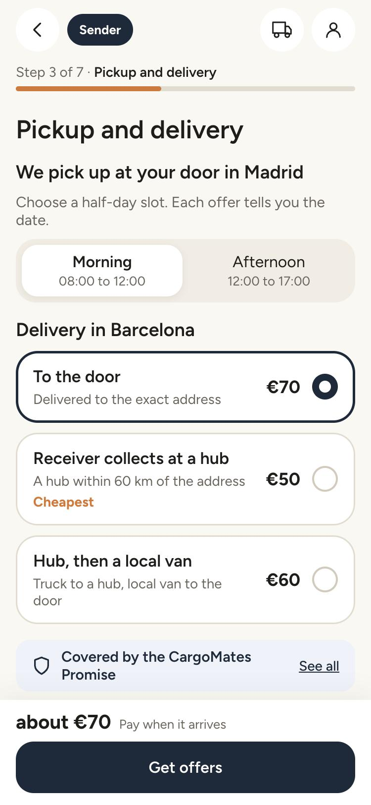
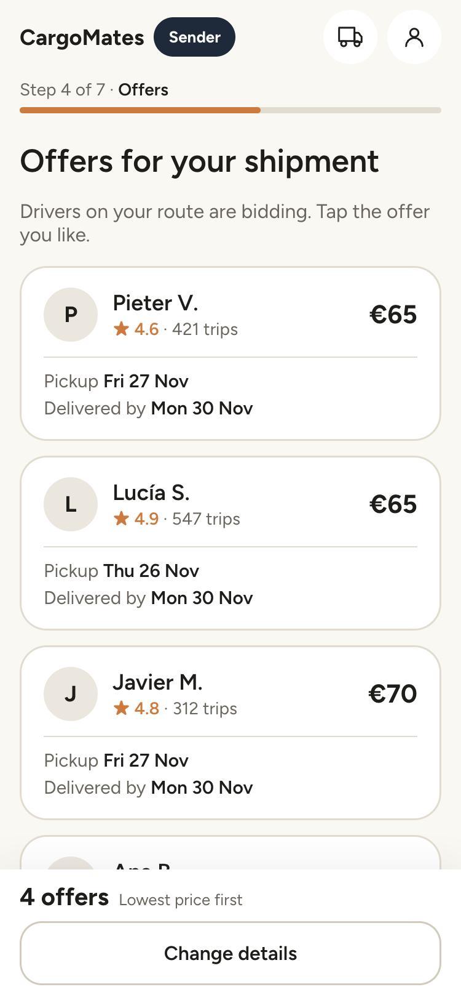
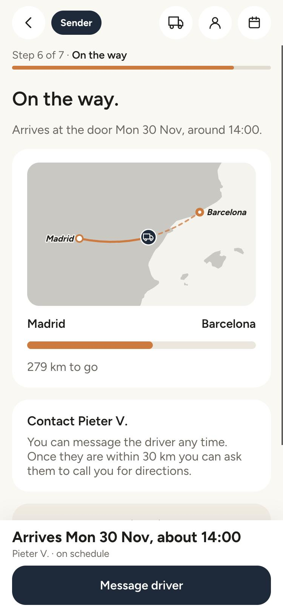
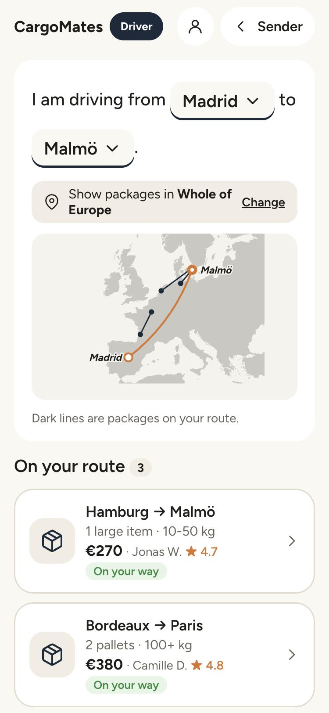
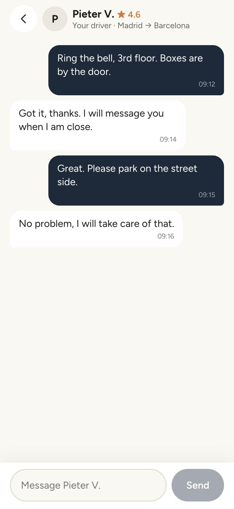
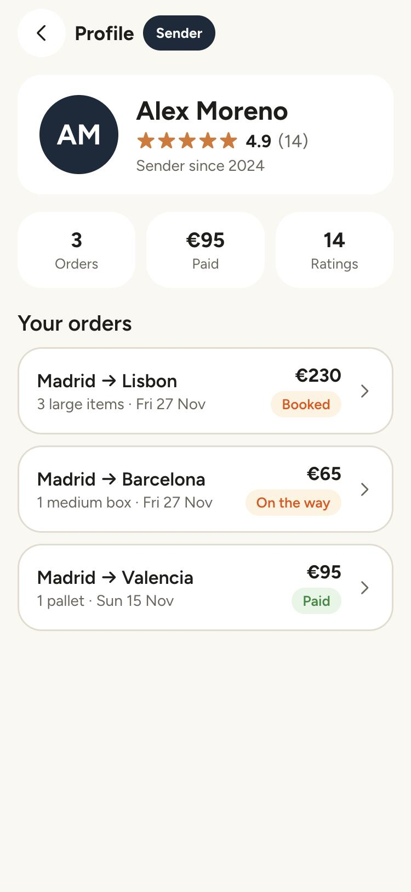

# CargoMates

A clickable prototype of a shipping marketplace for small businesses, built around a sender in Madrid. Senders photograph what they want to ship, drivers already heading that way bid on it, and CargoMates stands behind the delivery with a guaranteed date. Built phone-first in Vue 3; everything behind the screens is mock data.



The **landing page** at `/` explains the service and sends people in as a sender ("Send something") or a driver ("I'm a driver"). The CargoMates logo in every top bar leads back to it.

## The sender

| Start with a photo | Pickup at your door | Drivers bid | Track it |
| :---: | :---: | :---: | :---: |
|  |  |  |  |

1. **Photo** of each package. Size and weight are estimated per box and can be corrected.
2. **Where and when**, written as one sentence you fill in. Customs only appears when the shipment crosses a border: a short description inside the EU, an invoice upload outside it (London, Zurich).
3. **Pickup and delivery.** Pickup is always at the sender's door in a morning or afternoon slot. Delivery is to the door, to a hub, or hub plus a local van.
4. **Offers.** Each driver's bid shows their rating, a pickup date and a guaranteed delivery date.
5. **Track and pay.** A route map shows the truck. Nothing is paid until it arrives.

Every booking is covered by the **CargoMates Promise**: a guaranteed delivery date, money back if it is late, a replacement truck within 48 hours, a refund plus credit for a no-show, one contact for any problem, and a half-day pickup slot.

## The driver

| Packages on your route | Chat | Profile and ratings |
| :---: | :---: | :---: |
|  |  |  |

1. **Enter your route** ("I am driving from Madrid to Malmö") and the countries you take jobs in. Packages are grouped into "On your route" and "A bit off your route", each with the extra kilometres it adds.
2. **Bid** with a price, a pickup time and a pickup place.
3. **Pick up** with photos, get a tracking label, and **drop off** with a photo and a QR scan.

Sender and driver talk through an in-app **chat**; the sender's note on the booking is the first message. Senders cannot call drivers, but can ask for a call once the truck is within 30 km. Both sides have a **profile** with a star rating: orders for the sender, completed jobs for the driver.

## Run it

```bash
npm install
```

```bash
npm run dev
```

The dev server is also reachable on your network, so you can open it on a phone. It opens on the landing page; from there, or with the truck icon in the top bar, you can switch between Sender and Driver.

For a production build, `npm run build` writes to `dist/` and `npm start` serves it (used by the DigitalOcean deployment).

## How it is put together

```
src/
  store.js              all state, mock data, pricing, route matching, messages, tiny router
  mapData.js            land outline of Europe for the route map (Natural Earth, public domain)
  style.css             shared tokens and classes, plus the phone layout rules
  App.vue               picks the screen from the current route
  components/
    PageLayout.vue      sender shell: top bar, progress (step bar on phones), fixed action bar
    Tracker.vue         the progress list ("You are here")
    RouteMap.vue        map with a curved route, truck position and optional package legs
    Guarantees.vue      the CargoMates Promise, as a panel or a one-line link to a sheet
    Picker.vue          underlined word that opens a bottom sheet with big options
    AddressField.vue    destination input with suggestions
    Icon.vue            the few stroke icons used
  views/                one file per screen: Landing.vue is the front page, Driver*.vue the driver side
```

## What is fake (swap later)

- **Pricing**: `priceFor()` in `store.js` is a made-up formula.
- **Cities and distances**: `CITIES` (road km from Madrid) and `EXTRA_PLACES` in `store.js`. Replace with an address API.
- **Photo analysis**: `addPhotos()` invents plausible dimensions and weight for each photo.
- **Offers and dates**: `startBidding()` generates two to four bids with dates worked out from distance.
- **Driver's packages**: `MOCK_PACKAGES`. The sender's shipment and the driver's package list are not connected to each other.
- **Route matching**: `driverMatches` compares straight-line distances with a road factor, not real routes.
- **Map and live position**: the route is a stylised curve and the truck sits at a fixed 55 % until you tap "Skip".
- **Chat**: the other side answers with canned replies.
- **Profiles and ratings**: `PROFILES` and the seeded past jobs are placeholders, and there is no way to give a rating yet.
- **Guarantee amounts**: the figures in `GUARANTEES` are placeholders.
- **Payment**: the Pay button just marks it paid.
- **Storage**: the draft, order history and driver route live in `localStorage`.

## Notes

- Routing is a tiny hash router in `store.js` (`go('details')`). Swap for vue-router when the app grows.
- `preview.html` loads the same `.vue` files straight in the browser (no build). Only used for the hosted preview.
